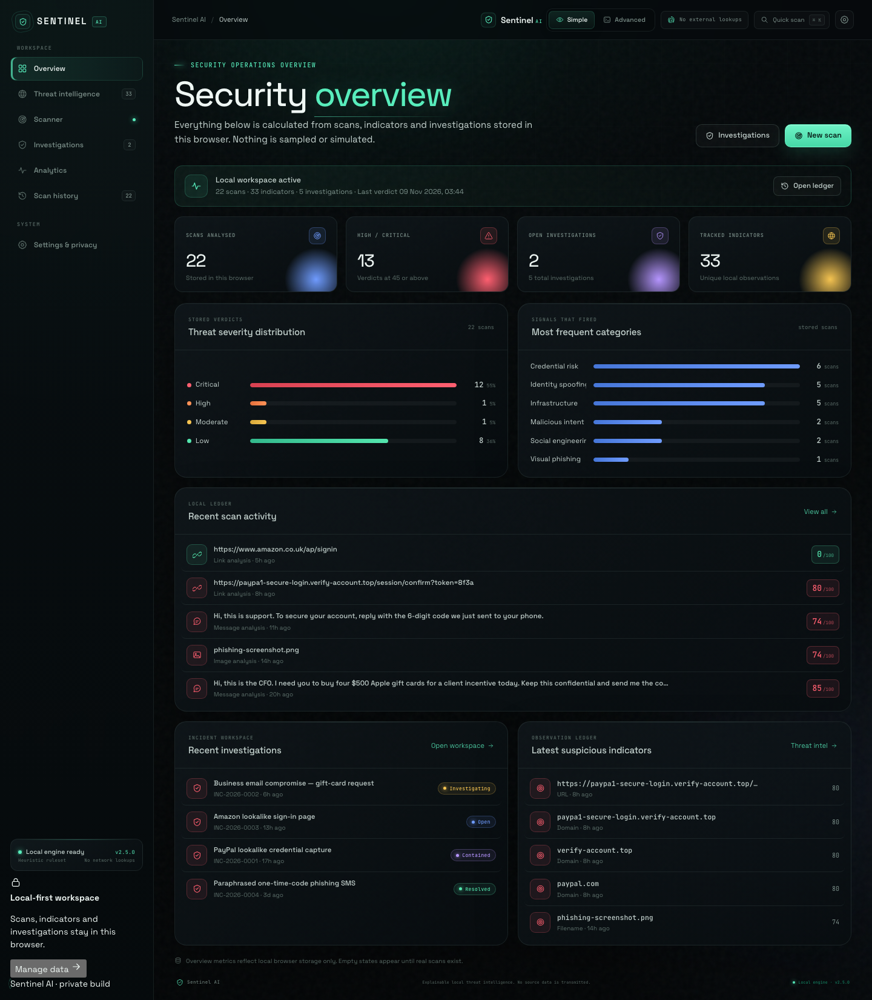
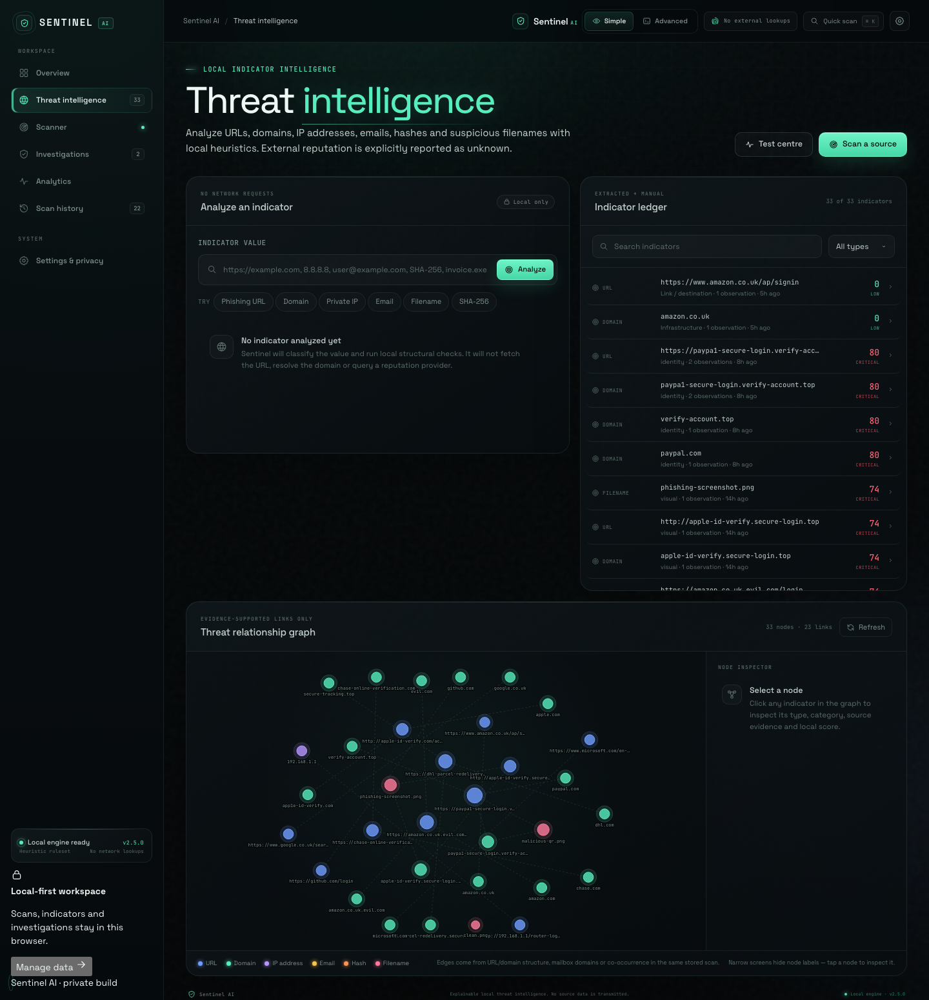
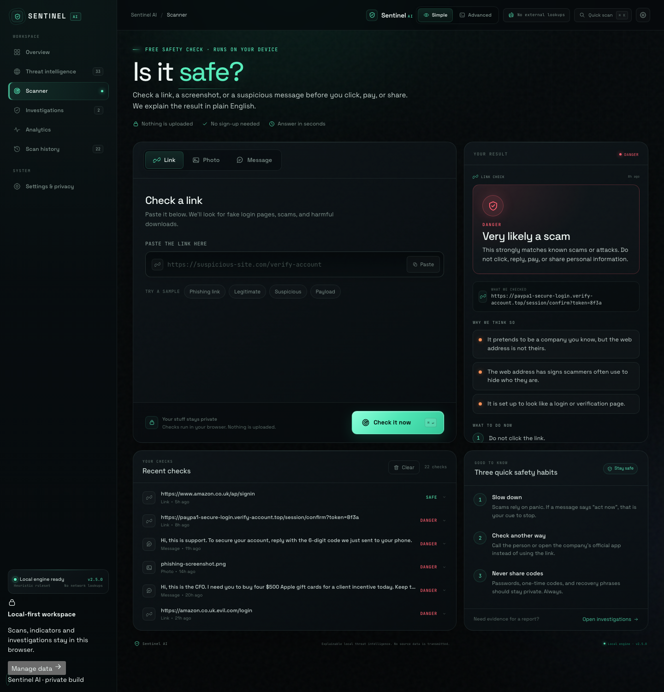
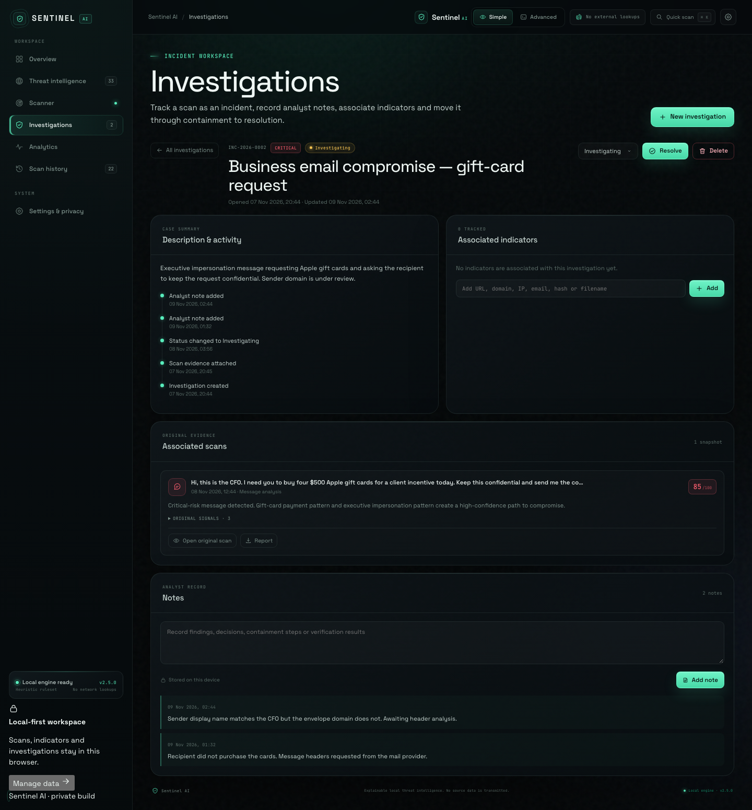
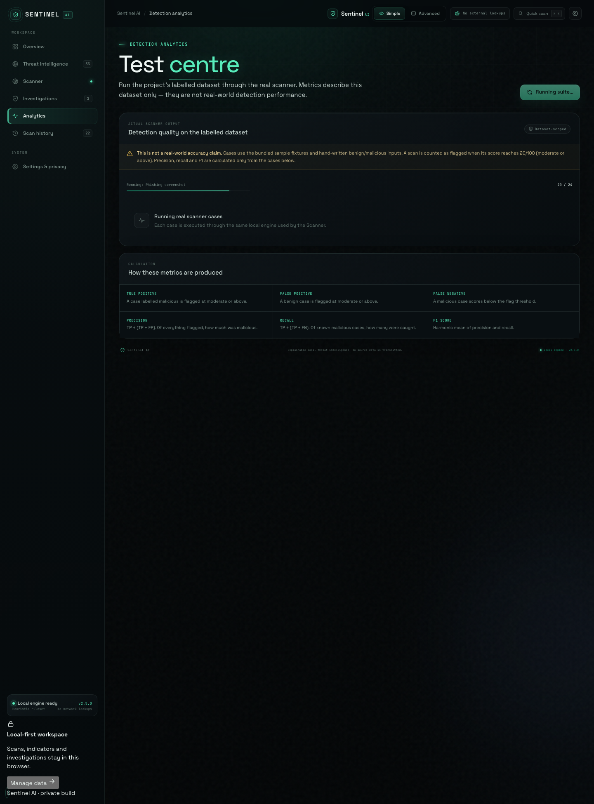
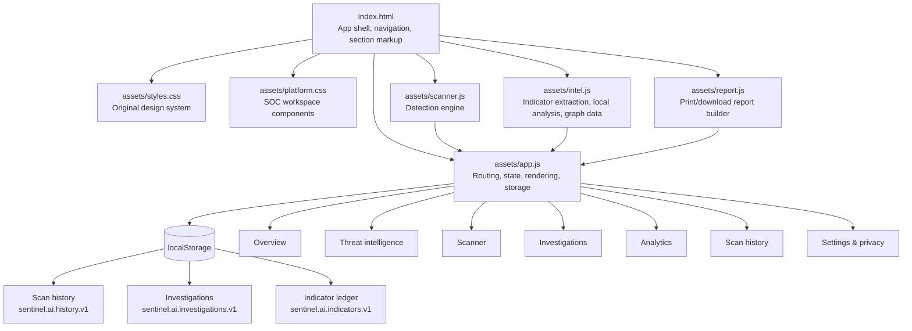

# Sentinel AI

Live demo: https://yz992.github.io/sentinel-ai/

**A local-first threat detection and investigation workspace for suspicious links, images, QR codes and messages.**

Built with AI-assisted development (Claude).

Sentinel AI is a static, dependency-free SOC-style workspace that runs entirely in the browser. It analyses a target with a deterministic, explainable detection engine, produces a 0–100 risk score with evidence and recommended actions, and lets you turn that result into a tracked investigation. Scan history, extracted indicators, investigations and reports stay on the device. No account, API key, backend or network reputation lookup is required.

The same engine powers two reading levels:

- **Simple** — plain-language verdicts (**SAFE**, **CAUTION**, **RISKY**, **DANGER**), short reasons and immediate next steps for everyday users.
- **Advanced** — numeric score, confidence, category breakdown, full detection signals, image forensics and exportable reports for analysts and security teams.

---

## Table of contents

- [Feature overview](#feature-overview)
- [Screenshots](#screenshots)
- [Architecture](#architecture)
- [Detection engine](#detection-engine)
- [Scoring methodology](#scoring-methodology)
- [Installation](#installation)
- [Using the workspace](#using-the-workspace)
- [Reports](#reports)
- [Detection test centre](#detection-test-centre)
- [Privacy and security](#privacy-and-security)
- [Local data reference](#local-data-reference)
- [Keyboard shortcuts](#keyboard-shortcuts)
- [Project structure](#project-structure)
- [Limitations](#limitations)
- [Future work](#future-work)
- [Technologies](#technologies)

---

## Feature overview

### Seven coordinated workspaces

| Workspace | What it does |
| --- | --- |
| **Overview** | Dashboard built only from stored scans, indicators and investigations. Severity distribution, indicator categories, recent activity and current investigation queue. Professional empty states when no data exists. |
| **Threat intelligence** | Normalises and analyses URLs, domains, IPv4/IPv6 addresses, email addresses, file hashes and suspicious filenames. Maintains a persistent indicator ledger with type, value, category, score, confidence, source scan, first/last observation and evidence. |
| **Scanner** | The original link, image and message scanner, preserved with Simple/Advanced result rendering, sample fixtures and local file handling. |
| **Investigations** | Creates incident records with a unique ID, title, severity, status, description, indicators, original scan evidence, analyst notes and timestamps. Supports status changes, notes, indicator association, resolution and deletion. |
| **Analytics** | Runs a labelled detection dataset through the real scanner and reports total cases, correct detections, false positives, false negatives, precision, recall and F1 from actual output. |
| **Scan history** | Searchable, filterable history of every stored scan with direct access to the original result and its report. |
| **Settings & privacy** | Documents local analysis and storage, shows storage usage and counts, and provides confirmed controls to clear history, investigations, the indicator ledger or all local data. |

### Threat intelligence and relationship graph

- Automatic indicator extraction from stored scans: URL destinations, hostnames, registrable domains, embedded message links, QR payloads, OCR text, hashes and image file names.
- Manual analysis of a single indicator without creating a scan.
- Local-only heuristics for suspicious domains, URL structure, IP ranges, free/disposable email providers, dangerous file extensions and hash format.
- **External reputation is always reported as `UNKNOWN`.** Sentinel has no live reputation provider and never implies that an unchecked value is safe.
- Native-SVG relationship graph limited to evidence-supported links:
  - URL ↔ its hostname and registrable domain
  - Email ↔ its mailbox domain
  - Indicators co-occurring in the same stored scan
- Click or keyboard-select any node to inspect its type, category, degree, highest local score, first/last observation and source evidence.

### Reports and export

- Self-contained, print-friendly HTML incident report with Sentinel branding, report ID, generated date/time, scan type and sanitised target.
- Verdict, 0–100 score, confidence, evidence signals, extracted indicators, recommended actions and associated investigation details.
- Browser-native actions: **Print report**, **Download HTML**, **Copy summary**, and **Export JSON** in Advanced view.
- Report filenames are sanitised. Local paths, browser APIs and internal engine objects are not written into reports.

### UX and accessibility

- Hash-based section routing with browser back/forward support.
- Visible focus states, keyboard-operable graph nodes, labelled form controls and `aria-current` navigation.
- Consistent loading, empty, success and error states.
- Confirmation dialog for every destructive action.
- Responsive tables, stacked cards and single-column layouts down to 360 px.
- No fake feeds, notifications, statistics, charts or placeholder buttons. Every number is derived from real stored data.

---

## Screenshots












---

## Architecture

Sentinel AI is a static single-page application. There is no build step and no server-side logic.



### Rendering model

- `app.js` owns a single state object and renders each section from stored data.
- The section router uses `#/overview`, `#/intel`, `#/scanner`, `#/investigations`, `#/analytics`, `#/history` and `#/settings`.
- Scanner results are rendered twice: Simple and Advanced views share the same underlying report.
- The relationship graph is generated as deterministic SVG coordinates in `intel.js`; no graph library is loaded.
- Reports are composed as escaped HTML strings in `report.js` and opened via a hidden iframe for printing or a Blob URL for download.

---

## Detection engine

The engine is deterministic and explainable. It does not call a network service and does not use machine-learning inference for verdicts.

### Links

- Brand impersonation on untrusted domains
- Typosquatting and lookalike domains using edit distance
- Punycode / IDN homograph checks
- Raw IP destinations, private/internal ranges and unusual ports
- Embedded credentials (`user:pass@`), `@` obfuscation and open redirects
- High-abuse TLDs, link shorteners, free hosting and tunnel services
- Credential, payment and account-verification paths
- Executable/archive downloads, double extensions and encoded payloads
- `javascript:`, `data:`, `vbscript:`, `file:` and `blob:` payload schemes

### Images and photos

- **EXIF / PNG text / XMP metadata** — camera, software, timestamps, comments and GPS fields
- **QR decoding** — the decoded destination is itself passed through the link engine
- **On-device OCR** — visible text is checked for phishing language, links and payloads
- **Synthetic-media provenance** — Midjourney, DALL·E, Stable Diffusion, Firefly, ComfyUI and related markers
- **Polyglot / hidden payload checks** — script markers, embedded executables, archive/PDF signatures and trailing bytes
- **Active SVG content** — scripts, event handlers, `foreignObject` and remote resources
- **File-type confusion** — extension and MIME mismatches
- **Computed hashes** — SHA-256 (and other available digests) stay on-device

### Messages

- Credential theft: OTPs, passwords, PINs, recovery phrases and private keys
- Gift-card fraud, wire transfers, crypto wallets and payment pressure
- Executive/CFO impersonation and business-email-compromise language
- Urgency, threats, account suspension, legal pressure and secrecy requests
- Brand impersonation and sensitive personal-data collection
- Malicious attachments and embedded links (links are deeply analysed)

> A suspicious signal means the content has traits commonly used in attacks. It does **not** confirm malware, a breach or malicious intent. Treat results as triage, not proof.

---

## Scoring methodology

### Score and verdict

| Score | Level | Plain-language verdict | Meaning |
| --- | --- | --- | --- |
| 0–19 | Low risk | `SAFE` | No meaningful indicators detected |
| 20–44 | Moderate risk | `CAUTION` | Suspicious traits warrant verification |
| 45–69 | High risk | `RISKY` | Multiple strong indicators |
| 70–100 | Critical threat | `DANGER` | High-confidence compromise path |

Scores are clamped to **0–100**. Signals carry weights, and the aggregate is calculated with diminishing returns so repeated weak signals cannot trivially reach 100.

### Signal de-duplication

- Signals are de-duplicated by signal ID before aggregation.
- The same evidence is never counted twice when it appears in multiple analyzer stages (for example a QR URL that is also a message link).
- The score reflects distinct evidence categories, not raw observation count.

### Severity floors

Some constructs are severe enough that a low total must not be presented as safe. The engine applies a minimum verdict floor for high-severity signals, including executable/embedded payloads and seed-phrase theft.

### Confidence is not severity

- **Score** answers *how risky does this look?*
- **Confidence** answers *how much evidence supports this result?*
- A high score with low confidence is possible, and the interface labels them separately.

### Unknown reputation is not safe

- External reputation is always `UNKNOWN` because Sentinel performs no live lookups.
- `UNKNOWN` is rendered distinctly from `SAFE` and never used to reduce a score.
- A clean result means only that no local heuristic fired.

### Benign examples

Benign fixtures are not automatically dangerous. Trusted services, ordinary messages and clean images should score low unless a real signal is present. The detection test centre includes benign cases specifically to catch false positives.

---

## Installation

### Requirements

- Python 3 (only to serve static files)
- A modern browser with JavaScript enabled

### Run locally

```bash
./start.sh
```

Then open **http://127.0.0.1:4173**.

If you prefer to start the server manually:

```bash
python3 -m http.server 4173 --bind 127.0.0.1
```

There is no install, build step, package manager, API key, account or paid service.

### Restart / stop

- Stop the server with `Ctrl C` in the terminal running `start.sh`.
- Restart by running `./start.sh` again.
- The app keeps working after a browser refresh; local data remains until cleared in **Settings & privacy**.

---

## Using the workspace

### First run

1. Open **Overview**. All metrics are zero until real scans exist.
2. Go to **Scanner** and try a bundled sample in Link, Image or Message mode.
3. Switch between **Simple** and **Advanced** in the top bar. The choice is saved.
4. Open **Threat intelligence** to see indicators extracted from scans and the relationship graph.
5. Create an **Investigation** from a result or from the Investigations workspace.
6. Run the **Analytics** test suite to verify detector behaviour on the labelled dataset.

### Investigations

Each investigation includes:

- Unique incident ID (`INC-YYYY-NNNN`)
- Title, severity and status (`Open`, `Investigating`, `Contained`, `Resolved`)
- Description and full timeline
- Associated indicators with local scores
- Original scan evidence with links to the source result
- Analyst notes with timestamps
- Resolution state and timestamps

Status changes, notes and indicator changes are persisted locally and appended to the timeline.

### Search and filtering

- Scan history: text search, severity filter and type filter.
- Indicator ledger: text search and indicator-type filter.
- Investigations: text search, status filter and severity filter.

---

## Reports

A report is generated from the stored report object and its current associated investigation.

It includes:

- Sentinel AI branding and report ID (`SR-XXXXXXXXXXXX`)
- Generated date and time
- Scan type, sanitised target, verdict, score and confidence
- Evidence signals with severity and explanation
- Extracted indicators with normalised values and categories
- Recommended actions
- Associated investigation details (ID, status, severity, notes and timeline) when present

Formats:

| Action | Output |
| --- | --- |
| **Print report** | Opens the browser print dialog with a print-optimised HTML document. Use **Save as PDF** for a PDF. |
| **Download HTML** | Downloads a self-contained `.html` report. |
| **Copy summary** | Copies a plain-text summary to the clipboard. |
| **Export JSON** (Advanced view) | Downloads a sanitised JSON object for tickets or automation. |

Reports never include local file paths, session identifiers or internal engine objects.

---

## Detection test centre

The Analytics workspace runs a labelled dataset of **18 cases** through the real scanner:

- 5 bundled scanner fixtures
- Additional malicious, benign and edge cases
- Image cases that exercise QR, OCR and metadata analysis

It reports:

- Total cases and execution errors
- True positives, true negatives, false positives and false negatives
- Precision = `TP ÷ (TP + FP)`
- Recall = `TP ÷ (TP + FN)`
- F1 = harmonic mean of precision and recall
- Per-case outcome with the detected score and verdict

**These metrics describe this bundled dataset only.** They are not a claim about real-world accuracy. Cases that error are excluded from precision/recall/F1 and shown separately. The flag threshold for the dataset is a score of **20 or above**.

---

## Privacy and security

### Local analysis

- Source content is read and analysed in the browser.
- Images are read as bytes on-device. QR decoding and OCR run locally; OCR uses a bundled WebAssembly/worker engine.
- No source content is uploaded to a server.

### Network requirements

- The app is served by a local Python static file server.
- The page loads only its own local assets (HTML, CSS, fonts, scripts, WASM and sample images).
- Analysed URLs are **not fetched**. Sentinel does not resolve DNS, query WHOIS, open the destination, or call reputation APIs.

### Stored data

- Scan history, investigations and indicators are stored in `localStorage`.
- History is capped at **50 scans**; the indicator ledger is capped at **500 entries**.
- History compaction removes heavy image metadata and hashes and truncates OCR/QR detail to keep storage compact.
- Clearing is explicit and confirmed:
  - Clear scan history
  - Clear investigations
  - Clear indicator ledger
  - Clear all local data

### Defensive implementation notes

- All user-controlled values are HTML-escaped before insertion.
- Dynamic rendering uses `textContent` where practical and escaped templates elsewhere.
- No `eval`, dynamic script injection or third-party analytics.
- Report HTML is composed from escaped values; downloads are generated with Blob URLs.
- Destructive actions require confirmation.
- Malformed URLs and unsupported schemes are rejected with a specific error message.
- File uploads are limited to supported image types and a 40 MB size limit.
- Report JSON exports deliberately omit local paths and internal fields.

> Local storage is not encrypted. Anyone with access to the browser profile can read it. Use a trusted device and clear data when it is no longer needed.

---

## Local data reference

| Key | Contents |
| --- | --- |
| `sentinel.ai.history.v1` | Stored scan reports (maximum 50) |
| `sentinel.ai.investigations.v1` | Investigations, notes, indicators and timelines |
| `sentinel.ai.indicators.v1` | Aggregated indicator ledger (maximum 500) |
| `sentinel.ai.indicators.seeded.v1` | One-time seed marker for indicators extracted from retained history |
| `sentinel.ai.view.v1` | Selected Simple/Advanced view |
| `sentinel.ai.section.v1` | Last selected workspace section |

Clearing the indicator ledger does not automatically re-import indicators from retained history; the seed marker prevents unexpected repopulation.

---

## Keyboard shortcuts

| Shortcut | Action |
| --- | --- |
| `⌘ K` / `Ctrl K` | Focus the scanner input |
| `⌘ Enter` / `Ctrl Enter` | Run the current scan from anywhere |
| `Enter` / `Space` | Activate a focused graph node |

---

## Project structure

```text
index.html                     Application shell and all workspace markup
README.md                      This document
start.sh                       Local static server (Python 3)

assets/styles.css              Original design system
assets/platform.css            SOC workspace components and responsive rules
assets/scanner.js              Deterministic detection engine
assets/intel.js                Indicator extraction, local analysis, graph data
assets/report.js               Print-friendly and downloadable reports
assets/app.js                  Routing, state, rendering, storage and controls

assets/jsQR.js                 Local QR decoder
assets/vendor/tesseract/       Local on-device OCR engine
assets/ocr/                    OCR language data
assets/fonts/                  Local Space Grotesk and JetBrains Mono
assets/samples/                Bundled scan fixtures
```

---

## Limitations

- **No live threat intelligence.** Sentinel does not query reputation feeds, WHOIS, DNS, certificate transparency, malware sandboxes or URL scanners.
- **No destination fetching.** A URL is analysed structurally; the page behind it is never opened.
- **Heuristics, not proof.** A low score is not a guarantee of safety. A high score is not proof of malware.
- **OCR and QR accuracy** depend on image quality, fonts and the bundled on-device engine.
- **Local storage only.** Data is tied to one browser profile and is not synced or encrypted.
- **No multi-user access control.** The workspace is designed for a single local analyst.
- **Dataset metrics are not general accuracy claims.** The test centre measures behaviour on its bundled cases only.
- **Filename and indicator extraction is conservative.** Some legitimate indicators may be missed to avoid false positives from truncated or plain-text content.

---

## Future work

- Optional, explicitly opt-in reputation provider integration with clear provenance
- IOC export formats such as STIX 2.1 and MISP-compatible JSON
- Browser-history and clipboard paste helpers with user consent
- Multi-scan correlation and case merging
- PDF export without relying on the browser print dialog
- Encrypted local storage with a user passphrase
- Additional detection datasets and per-case regression tracking
- Accessible dark/light theme and high-contrast mode
- Import/export of the full workspace for backup and transfer

---

## Technologies

- **HTML5** — semantic application shell
- **CSS3** — custom properties, Grid, Flexbox, container-free responsive layouts
- **Vanilla JavaScript** — no runtime framework or bundler
- **Native SVG** — relationship graph, icons, score rings and charts
- **Web APIs** — `localStorage`, `Blob`, `URL`, `FileReader`, Canvas, Clipboard, `iframe` printing
- **Tesseract.js** — bundled local OCR engine
- **jsQR** — bundled local QR decoder
- **Python 3** — static file server only

No third-party analytics, trackers, CDNs, accounts or paid services are used.
